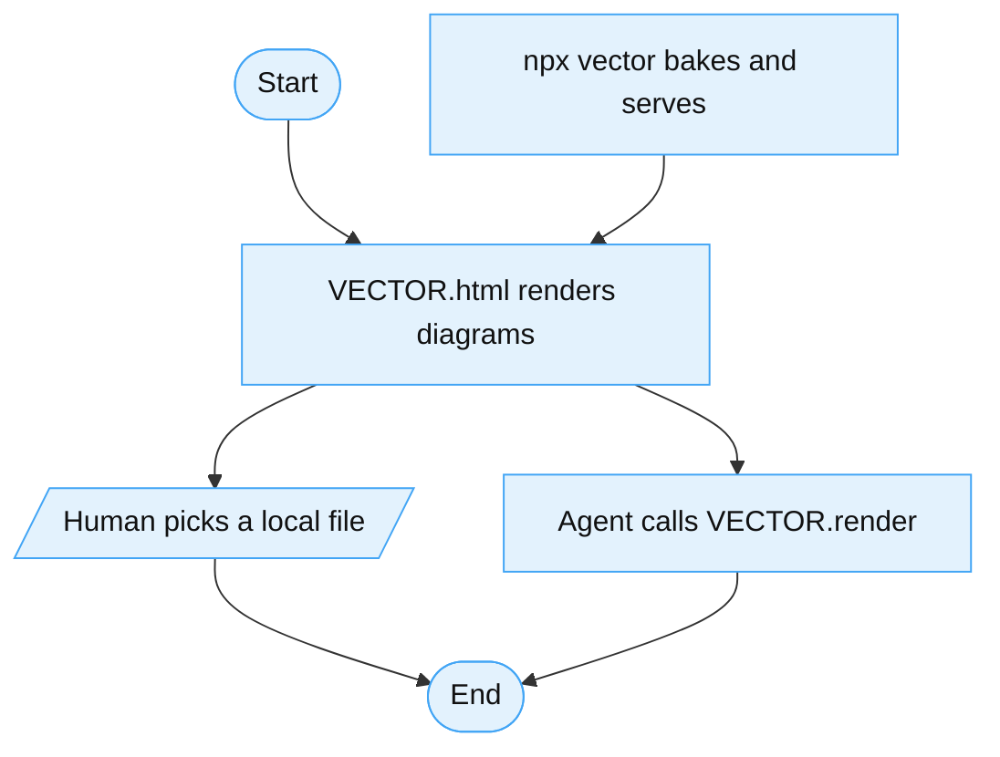

# VECTOR

[](https://github.com/SANIUL-blackdragon/VECTOR/actions)
[](LICENSE)


One HTML file that renders `.mmd` diagrams offline. No server. No network. No install. Also ships as an npm package. Built for easy driving by agents: every control has a hook, the console tells the full story, and `window.VECTOR` takes source text.

Try it live, no install: https://saniul-blackdragon.github.io/VECTOR/

Figure 1 Ways in



## Features

- Opens any local `.mmd` file and renders the diagram with no size caps.
- Starts at readable text size with the first region in view. Giants crop instead of shrinking.
- Pan, zoom, Fit, Reset, true size, and fullscreen from buttons or keys, with a live percent readout.
- Warns before sources over 50000 chars render, with proceed and cancel.
- Logs the full render story to structured console lines agents can read.
- Backend bakes a file into the viewer, serves one view, then exits.

## Requirements

- Chrome for the viewer.
- Node.js 18 or later for the backend and the test suite. Zero npm dependencies.

## Install

```bash
git clone https://github.com/SANIUL-blackdragon/VECTOR.git
cd VECTOR
node --version
```

The last line must print `v18` or later. Nothing else installs. The viewer is one file and the backend uses the standard library only.

## Install the package

The npm package is coming. The registry name is still open, so these commands wait on that decision.

```bash
npm install -g vector
vector diagram.mmd
```

Or without installing:

```bash
npx vector diagram.mmd
```

The address prints to stdout. The page opens once with the file baked in, serves the view, then the process exits and the port closes. Missing, unreadable, and non `.mmd` paths fail named with exit 1.

## Use it

Double-click `VECTOR.html`, or open it in Chrome with the network off. Pick any local `.mmd` file.

| Control | Button | Key |
|---|---|---|
| Zoom in and out | `+`, `-` | `+`, `-` |
| Fit whole diagram | Fit | `0` |
| Reset to readable default | Reset | `R` |
| True size | `1:1` | `1` |
| Pan | Arrow buttons | Arrow keys |
| Fullscreen | Full | `F` |
| Read zoom level | Percent readout | n/a |

Drag roams. Wheel and pinch zoom around the cursor. A bad file names its failure in the error panel, never a blank page.

## Drive it as an agent

Paste `VECTOR.help()` in the dev console. It prints all eight calls.

| Call | Effect |
|---|---|
| `await VECTOR.render(text)` | Renders source text, resolves when done |
| `VECTOR.reset()` | Returns the readable default, returns status |
| `VECTOR.fit()` | Shows the whole diagram, returns status |
| `VECTOR.zoom(1.25)` | Zooms about the center, under 1 zooms out |
| `VECTOR.pan(120, 0)` | Roams by pixels, right and down read positive |
| `VECTOR.status()` | Returns state, diagram, scale, position, and file |

Every call logs its own `api-*` console line. Every render logs file, timing, scale, and median. Parse errors name the failure in both the panel and the console. Agents driving the product load `skills/vector-driver/SKILL.md`.

## Backend

```bash
node backend.js diagram.mmd
```

The address prints to stdout. The page opens once with the file baked in, serves the view, then the process exits and the port closes. Unknown paths return 404 without counting as the view.

| Situation | Result |
|---|---|
| Valid `.mmd` path | Serves the baked diagram, exits after |
| Missing file | Named error, exit 1 |
| Non `.mmd` path | Named error, exit 1 |
| No argument | Usage, exit 1 |

Package footprint is 5.5 MB unpacked with zero dependencies. Publishing waits on a registry name.

## Test it

```bash
node tests/agent/suite.js
```

Sixteen checks run headless on isolated sessions: open, pick, zoom, pan, reset, fit, bad file, warn flow, a 680 box render, console contract, offline render with all network blocked, and backend serve plus clean exit. Green means the contract holds. Fixtures live in `tests/fixtures`.

## Project files

```text
VECTOR.html          Solo viewer, mermaid 12.1.0 inlined
backend.js           Minuscule local server, standard library only
package.json         Package manifest with the vector binary
tests/agent/         Headless acceptance suite
tests/fixtures/      Tiny, broken, and wrong-extension fixtures
docs/spec.md         Plan as built
docs/adr/            Architecture decision records
docs/agents/         Issue tracker, labels, and domain notes
CONTEXT.md           Glossary, state, contracts, lessons
```

## When it breaks

- Giant render blocks the tab for a couple of minutes. The warn panel says so first. Wait it out or cancel.
- A `file:` origin frame warning in the console on direct file open. Browser noise from inside the mermaid bundle. The render completes anyway.
- A local fixture fails to parse while another copy renders. `testing/` is gitignored and copies drift. Confirm the fixture before trusting proof.

## Roadmap

Open work lives in GitHub issues: #1 build spec and #8 giant render performance. Everything else is closed.

## Contribute

File issues on GitHub. Work stays on the `agent-sandbox` branch. Write detailed conventional commit messages, one concern per commit.

## License

MIT. See `LICENSE`.
