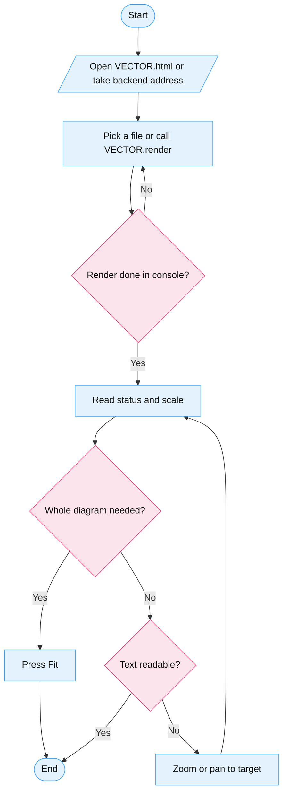

# Driving Vector

## Overview

VECTOR renders `.mmd` diagrams in one offline HTML file. It opens at readable text size, and every control works from buttons, keys, or the console. Drive it from the console when you hold source text. Drive it through the file picker or hooks when a human or browser is in the loop.

Figure 1 Drive loop

## Console API

Paste `VECTOR.help()` first. It prints all seven calls. The rest:

- `await VECTOR.render(text)` renders source text and resolves when done.
- `VECTOR.reset()` returns the readable default and returns status.
- `VECTOR.fit()` shows the whole diagram and returns status.
- `VECTOR.zoom(1.25)` zooms about the center. Values under 1 zoom out.
- `VECTOR.pan(120, 0)` roams by pixels. Right and down read positive.
- `VECTOR.status()` returns state, diagram presence, scale, position, and file.

Every call logs its own `api-*` console line, so quiet success still leaves a trail.

## Console events

Each line starts `[VECTOR] event=<name>` with `key=value` pairs. The names never change: `file-picked`, `file-read`, `file-rejected`, `render-start`, `render-done`, `render-failed`, `view-default`, `view-fit`, `error-shown`, `warn-shown`, `warn-proceed`, `warn-cancel`, `api-render`, `api-reset`, `api-fit`, `api-zoom`, `api-pan`, `api-status`, `api-help`, `fullscreen`. A named parse error in `render-failed` tells you exactly what broke in the source.

## Ways in

- Solo file. Open `VECTOR.html` in Chrome with the network off. Pick any local `.mmd` file.
- Backend. `npx vector diagram.mmd` bakes the source into the served viewer, opens it once, then exits. Missing or non-mmd paths fail named with exit 1.
- Browser hooks. Picker, canvas, all ten buttons, readout, warn panel, and error panel each carry a `data-testid` hook. Drive headless on an isolated session and profile. Never headed, never the human window.
- Suite. `node tests/agent/suite.js` runs sixteen checks headless. Green means the contract holds.

## Know before you drive

- Flowchart labels are HTML, not svg text. Select them in the DOM instead of searching for text nodes.
- Sources over 50000 chars pause on a warn panel. Click proceed or the render never starts.
- The default crops giants at top left by design. That is the readable region, not a bug. Fit shows the rest.
- Pan refuses moves past the clamp boundary. One refused direction is correct behavior. Try the other one.

## Common mistakes

- Reading the inlined mermaid bundle to understand the viewer. The viewer object sits past the bundle near the end of the file. Read that instead.
- Expecting Fit on load. Load gives the readable default. Fit lives behind its button and the `fit` call only.
- Trusting a quiet browser. Always read the console buffer back. Every action logs, so silence means the action never ran.
- Committing scratch notes or skill copies. `issue-*/` and `.skills/` stay gitignored.
